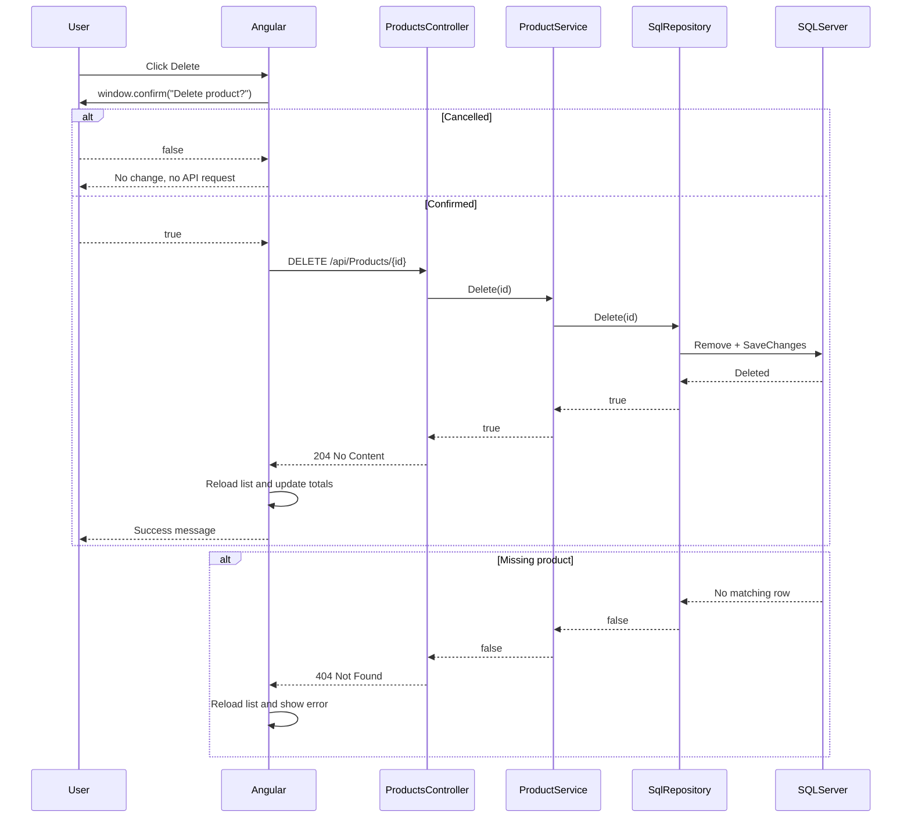
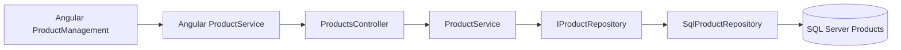

# Design: AIK-005 Delete Product

## Approach

Use the existing layered path:

`Angular ProductManagement -> ProductService.delete(id) -> DELETE endpoint -> IProductService.Delete -> IProductRepository.Delete -> EF Core Remove/SaveChanges -> SQL Server`

This keeps HTTP concerns in the controller, business orchestration in the application service, and persistence in the SQL repository. No migration is required because deletion does not alter the schema.

## File Impact Map

### Modified

- `ProductManagement.Application/Interfaces/IProductRepository.cs`
- `ProductManagement.Application/Interfaces/IProductService.cs`
- `ProductManagement.Application/Services/ProductService.cs`
- `ProductManagement.Infrastructure/Repositories/SqlProductRepository.cs`
- `ProductManagement.Infrastructure/Repositories/InMemoryProductRepository.cs`
- `ProductManagement.API/Controllers/ProductsController.cs`
- `product-management-ui/src/app/services/product.ts`
- `product-management-ui/src/app/products/product-management/product-management.ts`
- `product-management-ui/src/app/products/product-management/product-management.html`
- `product-management-ui/src/app/products/product-management/product-management.css`
- `docs/designs/AIK-005-requirements.md`

### Potential Tests

- Angular component/spec coverage for confirmation and API response behavior
- Backend tests if a supported test project is added

## API Contract

```yaml
DELETE /api/Products/{id}
Route constraint: id:int
Responses:
  204:
    description: Existing product deleted
  404:
    description: Product ID not found
```

## Service Flow

1. Controller calls `IProductService.Delete(id)`.
2. Service delegates to repository and returns whether a row was deleted.
3. SQL repository loads the tracked product, calls EF `Remove`, and saves changes.
4. Controller returns 204 for success or 404 for a missing product.
5. Angular calls `delete` only after `window.confirm` returns true.
6. Angular marks the product ID as deleting, preventing duplicates.
7. On successful `204`, Angular reloads products and updates count/value and success text.
8. On failure, Angular keeps current state and shows a useful error.

## Sequence Diagram



## Component Diagram



## Design Review

- Uses existing repository and service abstractions.
- Does not alter domain fields or database schema.
- Uses integer route constraints and typed HTTP delete result.
- No new dependency is introduced.
- UI state changes occur only after successful API response.
- Missing records are handled as normal `false` repository results.
